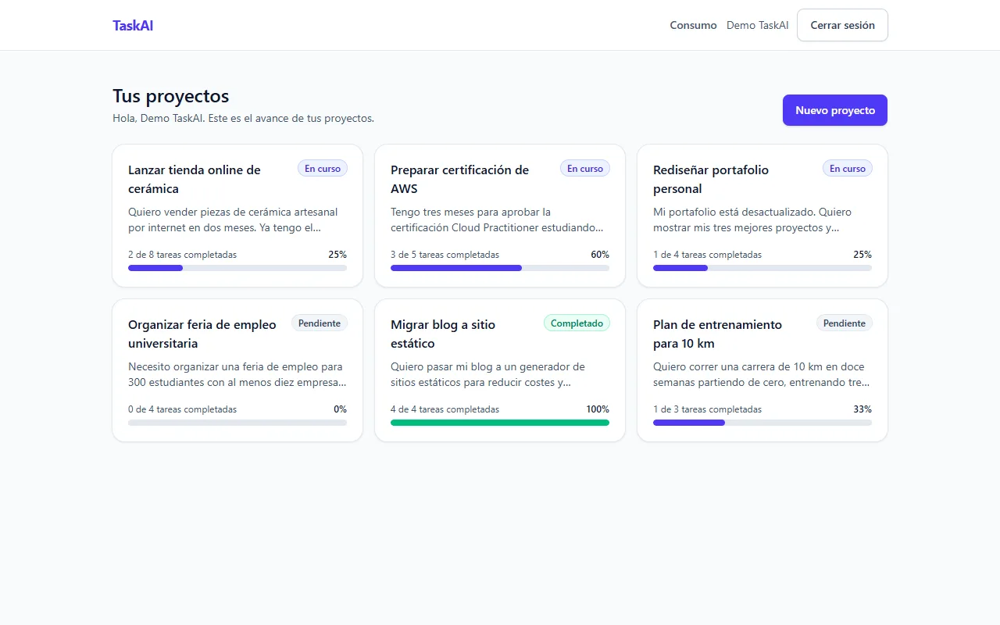
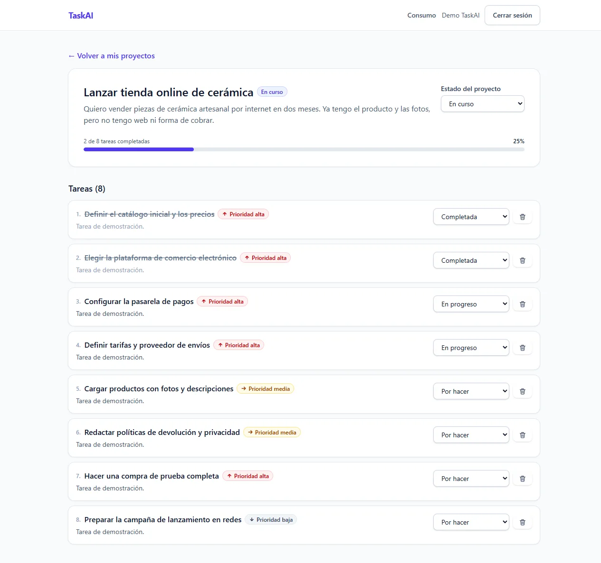
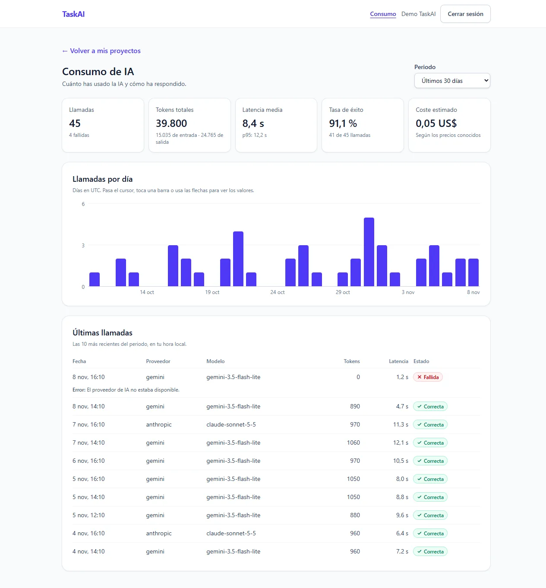
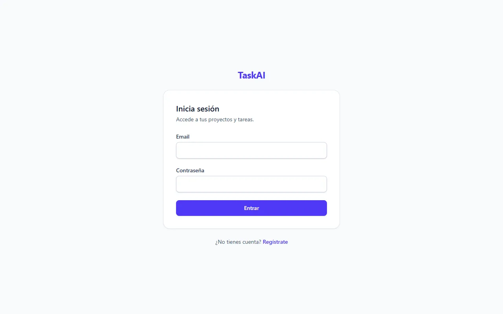
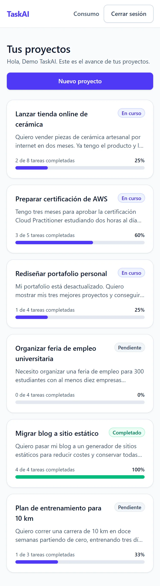
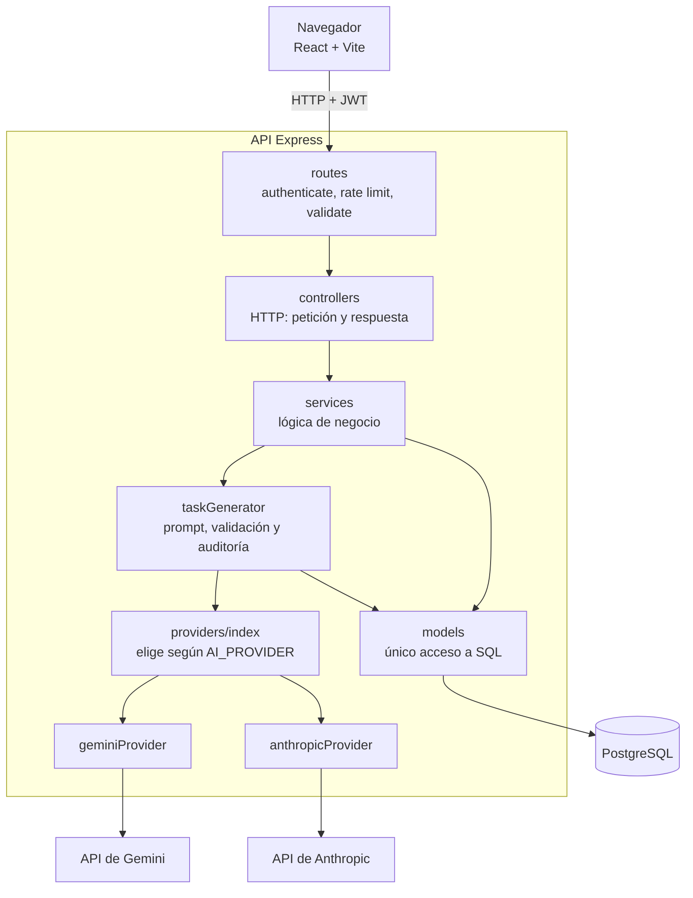

# TaskAI

Gestor de tareas en el que describes un proyecto en lenguaje natural y una IA genera sus tareas, ordenadas y priorizadas.

## Capturas

Todas las capturas usan datos de demostración creados con un script.







| Inicio de sesión | Panel en móvil |
|---|---|
|  |  |

## Qué demuestra este proyecto

- **Tratar la salida de un modelo como entrada no confiable.** La respuesta se pide con un JSON Schema y se vuelve a validar con Zod: de 3 a 15 tareas, con límites de longitud y prioridad cerrada. Si no cumple, se responde 502 y no se guarda nada.
- **Proveedores de IA intercambiables.** Gemini y Anthropic cumplen el mismo contrato y se eligen con `AI_PROVIDER`. Un test comprueba que cambiar de proveedor no toca `taskGenerator`.
- **Auditoría de consumo.** Cada llamada, correcta o fallida, guarda tokens, coste estimado y latencia. El panel agrega en SQL: p95, serie diaria sin huecos y desglose por modelo.
- **Autorización dentro de la consulta.** Cada lectura o escritura incluye al dueño en el propio SQL, y un recurso ajeno responde 404, igual que uno inexistente.
- **Transacciones cortas alrededor de una llamada lenta.** La IA se invoca antes de abrir la transacción, para no retener una conexión del pool durante decenas de segundos.
- **Interfaz accesible sin librerías extra.** Cambios optimistas con vuelta atrás si el servidor falla, y una gráfica en HTML y Tailwind con navegación por teclado y tabla para lectores de pantalla.

## Stack

| Pieza | Por qué |
|---|---|
| React 19 + Vite 8 | Interfaz por componentes y arranque rápido en desarrollo |
| Tailwind CSS 4 | Estilos en el propio componente, sin hojas CSS que mantener |
| React Router 7 | Rutas públicas y protegidas en una SPA |
| Node.js + Express 5 | Express 5 envía solo los errores de funciones `async` al manejador central |
| PostgreSQL | Transacciones, `FILTER`, `percentile_cont` y `generate_series` para las métricas |
| `pg` (sin ORM) | SQL explícito y parametrizado, visible en los modelos |
| node-pg-migrate | Migraciones versionadas con `up` y `down` |
| Zod 4 | Una sola librería para validar peticiones y salida de la IA, y para generar el JSON Schema |
| jsonwebtoken + bcryptjs | Sesión sin estado y contraseñas con hash; bcryptjs no requiere compilación nativa |
| helmet + express-rate-limit | Cabeceras de seguridad y límites por IP |
| `@google/genai` + `@anthropic-ai/sdk` | Los dos proveedores de IA soportados |
| Vitest + ESLint | Tests del backend y análisis estático del frontend |

## Arquitectura



Capas, flujo de una petición y creación de un proyecto paso a paso en [docs/ARQUITECTURA.md](docs/ARQUITECTURA.md). Referencia en [docs/API.md](docs/API.md) y [docs/BASE_DE_DATOS.md](docs/BASE_DE_DATOS.md).

## Decisiones de diseño

Registro completo, con alternativas, en [docs/DECISIONES.md](docs/DECISIONES.md).

- **Capa de IA intercambiable.** Cada proveedor recibe `{ systemPrompt, userPrompt, jsonSchema }` y devuelve `{ text, usage, model }`, y traduce sus errores a unos comunes. Así el resto del sistema no conoce ningún SDK, y añadir un proveedor no obliga a cambiar `taskGenerator`.
- **Validación de la salida con Zod.** Un JSON con la forma correcta puede traer datos inválidos, y el fallo aparecería días después. El mismo esquema Zod genera el JSON Schema enviado al modelo y valida la respuesta, de modo que no pueden desalinearse.
- **Auditoría de consumo.** Cada llamada tiene coste, también las fallidas si llegaron a consumir tokens. El coste es `NULL` si el modelo no tiene precio conocido, y no 0: desconocido y gratuito son cosas distintas.
- **Transacciones.** El proyecto y sus tareas se insertan juntos o no se inserta ninguno. La llamada a la IA queda fuera porque tarda segundos y el pool tiene 10 conexiones por defecto.
- **Protección contra IDOR.** El `UPDATE` o `DELETE` lleva la comprobación del dueño en la misma sentencia, sin una lectura previa. Un recurso ajeno da 404 para no revelar qué ids existen.
- **Login resistente a enumeración.** La respuesta es idéntica si el email no existe o si la contraseña es incorrecta, y `bcrypt.compare` se ejecuta siempre, contra un hash ficticio si hace falta, para que el tiempo tampoco lo revele. El registro sí revela si un email existe; ver [Seguridad](#seguridad).

## Seguridad

Amenazas y mitigaciones en [docs/SEGURIDAD.md](docs/SEGURIDAD.md).

**Implementado**

- Contraseñas con bcrypt (12 rondas por defecto) y política mínima: de 8 a 72 caracteres, con mayúscula, minúscula y número.
- JWT con algoritmo fijado a HS256 y caducidad de 7 días.
- Validación con Zod de cuerpo, parámetros y query; SQL siempre parametrizado.
- Comprobación del dueño en las consultas de proyectos y tareas; el consumo se filtra por el usuario del token.
- Límites por IP: 100 peticiones cada 15 min en general, 20 de login o registro cada 15 min y 10 generaciones con IA por hora.
- helmet, CORS limitado a `CLIENT_URL` y cuerpo JSON de hasta 100 KB.
- El detalle técnico de los errores de IA se queda en la base de datos; el usuario solo ve un mensaje genérico.

**No implementado**

- El token se guarda en `localStorage`, legible por cualquier script si hubiera un XSS. La alternativa es una cookie `httpOnly` con `Secure` y `SameSite`, lo que exige cambiar el backend y añadir protección CSRF.
- Cerrar sesión solo borra el token del navegador: sigue siendo válido hasta que caduca. No hay lista de revocación ni refresh tokens.
- El registro responde 409 si el email ya existe, así que permite comprobar qué emails están registrados.
- No hay verificación de email ni recuperación de contraseña.
- Los límites son por IP y se guardan en memoria: se reinician con el servidor y no se comparten entre instancias.
- El servidor no gestiona HTTPS y el proyecto no está desplegado.

## Cómo correrlo localmente

Requisitos: Node.js 20.19 o superior y PostgreSQL con `psql` en el `PATH`. Probado con una copia limpia del repositorio en Windows 11, Node 22.14 y PostgreSQL 16.15.

**1. Instalar dependencias**

```bash
cd backend && npm ci
cd ../frontend && npm ci
cd ..
```

**2. Crear la base de datos** (desde la raíz; pedirá la contraseña de `postgres`)

```bash
psql -U postgres -c "CREATE USER taskai_user WITH PASSWORD 'cambia_esta_password';"
psql -U postgres -c "CREATE DATABASE taskai OWNER taskai_user;"
```

**3. Configurar las variables de entorno**

```bash
cp backend/.env.example backend/.env
cp frontend/.env.example frontend/.env
```

En `backend/.env` cambia estos valores:

| Variable | Valor |
|---|---|
| `DATABASE_URL` | La conexión del paso 2. Con los valores de ejemplo no hay que tocarla |
| `JWT_SECRET` | El resultado de `node -e "console.log(require('crypto').randomBytes(64).toString('hex'))"` |
| `GEMINI_API_KEY` | Una clave de [Google AI Studio](https://aistudio.google.com/apikey) |

Sin una clave válida la aplicación arranca, pero crear un proyecto responde 503. Para usar Anthropic, pon `AI_PROVIDER=anthropic` y rellena `ANTHROPIC_API_KEY`.

En el nivel gratuito, Google puede usar el contenido enviado para mejorar sus productos: no escribas datos sensibles en las descripciones.

**4. Aplicar las migraciones**

```bash
cd backend && npm run migrate:up
cd ..
```

**5. Arrancar** (cada línea en su propia terminal, desde la raíz)

```bash
cd backend && npm run dev     # http://localhost:4000
cd frontend && npm run dev    # http://localhost:5173
```

Comprueba la API con `curl http://localhost:4000/api/health`. El frontend usa siempre el puerto 5173 porque es el origen que CORS permite por defecto.

Si Gemini responde que el modelo está saturado, cambia `GEMINI_MODEL` por otro de los que indica `.env.example`.

## Pruebas

```bash
cd backend
npm test           # 38 tests con Vitest
cd ../frontend
npm run lint       # ESLint
npm run build      # build de producción
```

Los tests no llaman a ninguna API externa ni necesitan base de datos. Cubren:

- Fábrica de proveedores y validación de la configuración, sin mostrar claves.
- Gemini: parámetros de la petición, reintentos ante 503, errores sin reintento, clave inválida y respuesta cortada.
- Anthropic: traducción de errores y respuesta cortada.
- `taskGenerator`: JSON válido, JSON roto, esquema inválido, respuesta cortada, error inesperado, y que un fallo de auditoría no oculte el resultado.
- Precios: modelo sin precio y precio vigente según la fecha.
- Panel de consumo: clasificación de errores y que `error_message` nunca salga del servidor.

No hay tests automatizados de las rutas HTTP, de la autenticación, de las consultas SQL ni del frontend. Esos flujos se verificaron a mano durante el desarrollo, con `curl` y Chrome sin interfaz, pero esas comprobaciones no forman parte del repositorio.

## Limitaciones conocidas y próximos pasos

- **Generación en segundo plano.** La petición queda abierta mientras la IA responde. Si se cierra la pestaña, el servidor termina y guarda el proyecto, pero el usuario no recibe la respuesta. Un trabajo en segundo plano con consulta de estado lo resolvería.
- **Idempotencia.** El frontend evita el doble envío, pero repetir la petición crea otro proyecto y gasta otra llamada. Una clave de idempotencia por intento lo evitaría.
- **Despliegue.** No está desplegado. El código ya contempla `TRUST_PROXY`, SSL en la base de datos y apagado ordenado con `SIGTERM`.
- **Límites compartidos y por usuario.** Requieren un almacén común como Redis.
- **Más cobertura de tests.** Sobre todo las rutas HTTP y el aislamiento entre usuarios.
- **Funciones ausentes.** No se pueden editar los textos de una tarea, añadir tareas a mano ni borrar proyectos.
- **Cuerpos de más de 100 KB.** Se rechazan con 500 en lugar de 413.
- **Tipo de error de IA.** Se deduce del texto guardado; una columna `error_code` sería más fiable.


