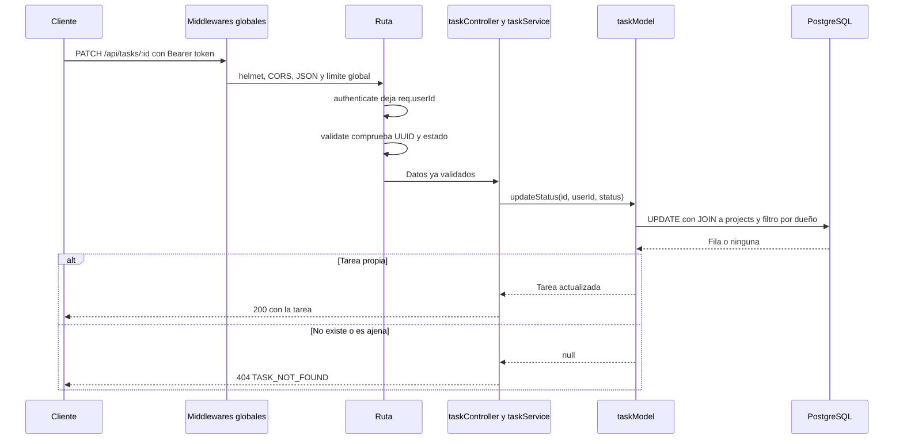
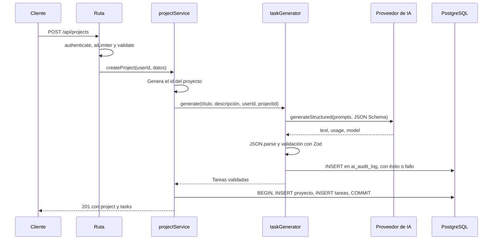

# Arquitectura

TaskAI es una SPA en React que consume una API REST en Express con PostgreSQL. La generación de tareas se delega a un proveedor de IA externo.

Volver al [README](../README.md).

## Capas del backend

Cada capa solo conoce a la siguiente.

| Capa | Carpeta | Responsabilidad | No hace |
|---|---|---|---|
| Rutas | `backend/src/routes` | Asocia URL con middlewares y controller | Lógica |
| Middlewares | `backend/src/middlewares` | Autenticación, límites de uso y errores | Acceso a datos |
| Validadores | `backend/src/validators` | Esquemas Zod de cuerpo, parámetros y query | Reglas de negocio |
| Controllers | `backend/src/controllers` | Lee la petición y escribe la respuesta | SQL |
| Services | `backend/src/services` | Lógica de negocio y transacciones | HTTP |
| Capa de IA | `backend/src/services/ai` | Prompt, proveedores, precios y validación de la salida | SQL directo |
| Models | `backend/src/models` | Únicas consultas SQL de la aplicación | HTTP |

Express 5 envía al manejador central los errores de las funciones `async`, así que los controllers no necesitan `try/catch`. Los modelos y servicios lanzan `AppError`, y `errorHandler` lo convierte en la respuesta JSON `{ error: { code, message, details? } }`.

## Flujo de una petición

Ejemplo: `PATCH /api/tasks/:id`.



## Crear un proyecto con IA

`POST /api/projects` es el flujo central.



Paso a paso:

1. `authenticate` comprueba el token. `aiLimiter` va después, así que una petición sin token no gasta cupo de IA.
2. `validate` exige un título de 3 a 100 caracteres y una descripción de 20 a 2000.
3. `projectService` genera el id con `randomUUID()`. Se necesita antes de que exista el proyecto, porque la auditoría debe referenciarlo.
4. `taskGenerator` pide al proveedor activo una respuesta con la forma del JSON Schema. El texto del usuario va delimitado con `<proyecto>` y el prompt de sistema indica que no son instrucciones.
5. El proveedor traduce cualquier error de su SDK a los errores comunes de `services/ai/errors.js`:
   - Autenticación, cuota, red o servicio caído: 503 `AI_UNAVAILABLE`.
   - Rechazo de la petición: 502 `AI_ERROR`.
   - Respuesta cortada o inutilizable: 502 `AI_INVALID_RESPONSE`.
6. La respuesta se parsea y se valida con Zod: de 3 a 15 tareas, título de 3 a 150 caracteres, descripción de 10 a 600 y prioridad `low`, `medium` o `high`.
7. Un bloque `finally` registra la llamada en `ai_audit_log`, haya salido bien o mal. Si esa escritura falla, se registra en consola y no oculta el resultado de la IA.
8. Con las tareas validadas se abre una transacción corta: `INSERT` del proyecto y un único `INSERT` múltiple de las tareas. Si algo falla, `ROLLBACK`.

### Reintentos y tiempos

| Proveedor | Tiempo por intento | Reintentos |
|---|---|---|
| Gemini | 60 s | Propios: hasta 2 más, tras 1 s y 3 s, solo ante 503 o 429. Un timeout no se reintenta |
| Anthropic | 60 s | Del SDK: hasta 2 más, ante 429, 5xx y errores de red |

Los reintentos automáticos del SDK de Gemini están desactivados porque en `@google/genai` 2.32.0 fallan con `TypeError: unusable`, al reenviar un cuerpo ya consumido, y ocultan el error real.

`latency_ms` mide desde antes del primer intento hasta el final, con los reintentos incluidos.

### Por qué la llamada a la IA va fuera de la transacción

Una transacción retiene una conexión del pool desde `BEGIN` hasta `COMMIT`. La llamada a la IA tarda segundos y, con timeout, reintentos y esperas, puede superar el minuto.

El pool tiene 10 conexiones por defecto (`DB_POOL_MAX`) y una petición espera 5 s como máximo para conseguir una. Con la IA dentro de la transacción, diez generaciones simultáneas dejarían sin conexiones a toda la API, incluidas las lecturas más simples. Esas conexiones estarían sin hacer nada, a la espera de un servicio externo.

Con la llamada fuera, la transacción solo dura dos `INSERT`.

Consecuencias de este diseño:

- `project_id` en `ai_audit_log` no tiene clave foránea (migración `1761436800005`), porque la auditoría se escribe antes de que exista el proyecto y también cuando nunca llega a existir.
- Si la IA responde bien y la transacción falla después, los tokens ya se gastaron: queda una auditoría `success` cuyo `project_id` no corresponde a ningún proyecto.
- Si el usuario cierra la pestaña, el servidor no lo detecta y completa el proceso. El proyecto aparece en su panel la próxima vez.

## Capa de proveedores de IA

Cada proveedor exporta `name`, `DEFAULT_MODEL`, `API_KEY_ENV`, `getModel()` y `generateStructured({ systemPrompt, userPrompt, jsonSchema })`, que devuelve `{ text, usage: { promptTokens, completionTokens }, model }`.

`server.js` llama a `validateAiConfig()` al arrancar y se detiene con un mensaje claro si el proveedor no es válido o falta su clave.

Para añadir un proveedor:

1. Crear su archivo en `services/ai/providers` con ese contrato y traducir sus errores a los comunes.
2. Registrarlo en `providers/index.js`.
3. Añadir sus precios en `pricing.js`.
4. Añadir sus variables a `.env.example`.

`taskGenerator.js` no cambia.

El coste se calcula con `pricing.js`. Un modelo que no está en la tabla registra `NULL`. Los precios son estimaciones basadas en las páginas oficiales citadas en ese archivo y hay que actualizarlos a mano.

## Frontend

```text
frontend/src
├── api/          Cliente HTTP central y llamadas por recurso
├── context/      Sesión del usuario (AuthProvider)
├── hooks/        useAuth, useForm, useResource, useProjectDetail
├── routes/       Rutas públicas y protegidas
├── pages/        Una por pantalla
├── components/   ui, layout, projects, tasks, usage
├── i18n/es.js    Todos los textos de la interfaz
└── utils/        Validación, formato y almacenamiento del token
```

- **Sesión.** Al cargar, si hay un token guardado, `AuthProvider` lo comprueba con `GET /auth/me`. Cualquier 401 de una petición autenticada cierra la sesión. Un fallo de red no la cierra: muestra una pantalla con Reintentar.
- **Carga de datos.** `useResource` carga por clave, cancela la petición anterior con `AbortController` y conserva los datos previos mientras llegan los nuevos.
- **Cambios optimistas.** El estado de una tarea cambia en pantalla al momento y vuelve al valor anterior si el servidor falla. El selector se bloquea mientras se guarda para evitar carreras. El borrado no es optimista: la tarea desaparece cuando el servidor confirma.
- **Validación doble.** El frontend aplica los mismos límites que el backend para dar respuesta inmediata; la validación que cuenta es la del servidor.
