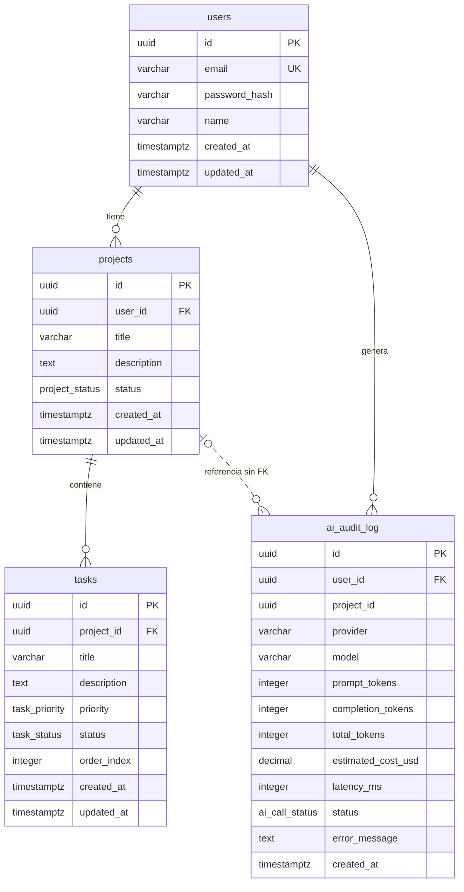

# Base de datos

PostgreSQL. El esquema se define con migraciones de node-pg-migrate en `backend/migrations`. Probado con PostgreSQL 16.15; las migraciones usan `gen_random_uuid()`, disponible desde PostgreSQL 13 sin extensiones.

Volver al [README](../README.md).

## Diagrama



## Tablas

### `users`

| Columna | Tipo | Notas |
|---|---|---|
| `id` | `uuid` | Clave primaria, `gen_random_uuid()` |
| `email` | `varchar(255)` | Único sin distinguir mayúsculas |
| `password_hash` | `varchar(255)` | Hash bcrypt; solo se consulta para el login |
| `name` | `varchar(100)` | |
| `created_at`, `updated_at` | `timestamptz` | `updated_at` lo mantiene un trigger |

### `projects`

| Columna | Tipo | Notas |
|---|---|---|
| `id` | `uuid` | Clave primaria |
| `user_id` | `uuid` | FK a `users`, `ON DELETE CASCADE` |
| `title` | `varchar(200)` | La API limita a 100 caracteres |
| `description` | `text` | Texto que se envía a la IA |
| `status` | `project_status` | `pending` (por defecto), `active`, `completed` |
| `created_at`, `updated_at` | `timestamptz` | |

### `tasks`

| Columna | Tipo | Notas |
|---|---|---|
| `id` | `uuid` | Clave primaria |
| `project_id` | `uuid` | FK a `projects`, `ON DELETE CASCADE` |
| `title` | `varchar(255)` | La validación de la IA limita a 150 caracteres |
| `description` | `text` | |
| `priority` | `task_priority` | `low`, `medium` (por defecto), `high` |
| `status` | `task_status` | `todo` (por defecto), `in_progress`, `completed` |
| `order_index` | `integer` | Orden de ejecución; `CHECK (order_index >= 0)` |
| `created_at`, `updated_at` | `timestamptz` | |

### `ai_audit_log`

Una fila por cada llamada a la IA, correcta o fallida. No tiene `updated_at`: un registro de auditoría no se modifica.

| Columna | Tipo | Notas |
|---|---|---|
| `id` | `uuid` | Clave primaria |
| `user_id` | `uuid` | FK a `users`, `ON DELETE CASCADE` |
| `project_id` | `uuid` | Admite nulos y no tiene FK; ver abajo |
| `provider` | `varchar(50)` | `gemini` o `anthropic` |
| `model` | `varchar(100)` | Modelo que atendió la llamada |
| `prompt_tokens`, `completion_tokens`, `total_tokens` | `integer` | Por defecto 0. En Gemini, `completion_tokens` incluye los tokens de razonamiento |
| `estimated_cost_usd` | `decimal(10,6)` | `NULL` si el modelo no tiene precio conocido; 0 en el nivel gratuito |
| `latency_ms` | `integer` | Incluye reintentos |
| `status` | `ai_call_status` | `success` o `error` |
| `error_message` | `text` | Detalle técnico, hasta 1000 caracteres. La API no lo expone |
| `created_at` | `timestamptz` | |

## Relaciones y borrado

- Borrar un usuario borra sus proyectos y su historial de auditoría.
- Borrar un proyecto borra sus tareas.
- La API actual solo permite borrar tareas; no expone el borrado de usuarios ni de proyectos.

`ai_audit_log.project_id` es una referencia sin clave foránea. La migración original la definía con `ON DELETE SET NULL`, y `1761436800005` la eliminó porque la auditoría se escribe antes de crear el proyecto y también cuando la IA falla y el proyecto nunca existe.

## Índices

| Tabla | Índice | Para qué |
|---|---|---|
| `users` | Único sobre `lower(email)` | Unicidad y búsqueda sin distinguir mayúsculas |
| `projects` | `(user_id, created_at DESC)` | Proyectos de un usuario, los recientes primero |
| `tasks` | `(project_id, order_index)` | Tareas de un proyecto en orden |
| `ai_audit_log` | `(user_id, created_at DESC)` | Consumo por usuario y periodo |
| `ai_audit_log` | `(project_id)` | Búsqueda por proyecto |
| `ai_audit_log` | `(provider, model)` | Agregados por proveedor y modelo |

## Triggers y funciones

La función `set_updated_at()` actualiza `updated_at` antes de cada `UPDATE`, mediante los triggers `users_set_updated_at`, `projects_set_updated_at` y `tasks_set_updated_at`.

## Migraciones

| Archivo | Contenido |
|---|---|
| `1761436800000_initial-setup` | Función `set_updated_at` |
| `1761436800001_create-users` | Tabla `users` |
| `1761436800002_create-projects` | Tipo `project_status` y tabla `projects` |
| `1761436800003_create-tasks` | Tipos `task_priority` y `task_status`, tabla `tasks` |
| `1761436800004_create-ai-audit-log` | Tipo `ai_call_status` y tabla `ai_audit_log` |
| `1761436800005_audit-log-drop-project-fk` | Elimina la FK de `project_id` |
| `1761436800006_audit-log-provider` | Añade `provider` y permite coste `NULL` |

```bash
cd backend
npm run migrate:up     # aplica las pendientes
npm run migrate:down   # revierte la última
```

node-pg-migrate registra las migraciones aplicadas en la tabla `pgmigrations`.

## Conexión

`backend/src/config/database.js` usa un pool de `pg` con 10 conexiones por defecto (`DB_POOL_MAX`), 30 s de inactividad y 5 s como máximo para conseguir conexión. `pg` devuelve `NUMERIC` y `BIGINT` como texto por defecto; aquí se convierten a `Number`, ya que los recuentos y los costes caben sin perder precisión.
